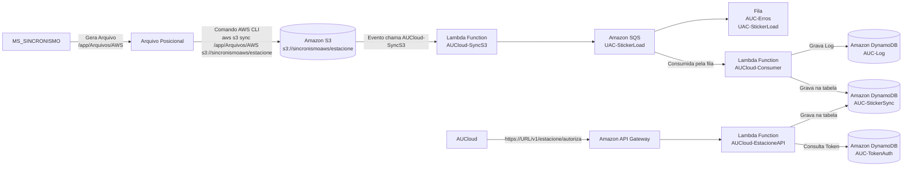

# Processo Seletivo AWS | Arquitetura Serverless com CloudFormation

Este projeto demonstra a construção de uma arquitetura **Serverless orientada a eventos na AWS**, utilizando **Amazon S3**, **AWS Lambda**, **Amazon SQS**, **Amazon DynamoDB**, **Amazon API Gateway** e **AWS CloudFormation**.

O objetivo é simular um cenário corporativo de sincronização de dados, no qual arquivos são enviados para um bucket S3, processados por funções Lambda e persistidos em tabelas DynamoDB para posterior consulta através de APIs.

---

# Arquitetura da Solução

## Fluxo de Negócio

1. Um sistema legado (**MS_SINCRONISMO**) gera arquivos posicionais.
2. Os arquivos são enviados para um bucket S3.
3. Um evento do S3 dispara a Lambda **AUCloud-SyncS3**.
4. A Lambda envia mensagens para a fila **UAC-StickerLoad**.
5. A Lambda **AUCloud-Consumer** consome as mensagens da fila.
6. Os dados são persistidos na tabela **AUC-StickerSync**.
7. Logs operacionais são armazenados na tabela **AUC-Log**.
8. Uma API exposta pelo **Amazon API Gateway** recebe requisições de autorização.
9. A Lambda **AUCloud-EstacioneAPI** consulta tokens na tabela **AUC-TokenAuth**.
10. A Lambda grava ou atualiza registros na tabela **AUC-StickerSync**.



# Serviços AWS Utilizados

| Serviço            | Finalidade                          |
| ------------------ | ----------------------------------- |
| Amazon S3          | Armazenamento dos arquivos enviados |
| AWS Lambda         | Processamento serverless            |
| Amazon SQS         | Comunicação assíncrona              |
| Amazon DynamoDB    | Persistência NoSQL                  |
| Amazon API Gateway | Exposição de APIs REST              |
| AWS IAM            | Controle de acesso                  |
| AWS CloudFormation | Infraestrutura como código          |

---

# Estrutura do Projeto

Plain Text

```shell
processo-seletivo/
│
├── infra/
│ └── cloudformation.json
│
├── docs/
│ └── arquitetura.md
│
├── lambda/
│ ├── syncs3/
│ │ └── lambda_function.py
│ │
│ ├── consumer/
│ │ └── lambda_function.py
│ │
│ └── estacione-api/
|	└── lambda_function.py
│
├── README.md
│
└── .gitignore
```

---

# Recursos Provisionados pelo CloudFormation

O template CloudFormation cria automaticamente:

### Storage

- Bucket S3
- Notificação de Evento S3

### Mensageria

- Fila Principal SQS
- Fila de Erros (DLQ)

### Computação

- Lambda AUCloud-SyncS3
- Lambda AUCloud-Consumer
- Lambda AUCloud-EstacioneAPI

### Banco de Dados

- DynamoDB AUC-StickerSync
- DynamoDB AUC-Log
- DynamoDB AUC-TokenAuth

### Integração

- Amazon API Gateway

### Segurança

- IAM Roles
- IAM Policies

---

# Hands-On

## Pré-requisitos

- Conta AWS
- AWS CLI instalada
- Git
- Permissões CloudFormation
- Permissões IAM
- Permissões Lambda
- Permissões S3
- Permissões DynamoDB

---

## 1. Clonar o Repositório


```shell
git clone https://github.com/Gustavo-Bento/processo-seletivo.git
cd processo-seletivo
```
---

## 2. Validar o Template

```Shell
aws cloudformation validate-template \
--template-body file://infra/cloudformation.json
```

Resultado esperado:

```shell
Template validated successfully
```

---

## 3. Criar a Stack

```Shell
aws cloudformation create-stack \
--stack-name processo-seletivo-stack \
--template-body file://infra/cloudformation.json \
--capabilities CAPABILITY_NAMED_IAM
```


---

## 4. Acompanhar a Criação

```shell
aws cloudformation describe-stacks \
--stack-name processo-seletivo-stac
```

ou

```shell
aws cloudformation wait stack-create-complete \
--stack-name processo-seletivo-stack
```

---

## 5. Verificar Recursos Criados

### Bucket

```shell
aws s3 ls
```

### DynamoDB

```shell
aws dynamodb list-tables
```

### Lambda

```shell
aws lambda list-functions
```

### API Gateway

```shell
aws apigateway get-rest-apis
```

---

# Testando o Fluxo

## Upload de Arquivo

Exemplo de payload:

```json
{
"id": "123",
"placa": "ABC1234",
"data": "2026-10-16",
"valor": 20.50
}
```

Salvar como:

```shell
arquivo.json
```

Enviar para o S3:

```shell
aws s3 cp arquivo.json \
s3://sincronismoaws-estacione/
```

---

## Verificar Processamento

Consultar itens persistidos:

```shell
aws dynamodb scan \
--table-name AUC-StickerSync
```

---

# Consumindo a API

Exemplo:

```shell
curl --request POST \
--url https://URL/v1/estacione/autoriza \
--header 'Content-Type: application/json' \
--data '{
"token":"123456"
}'
```

Fluxo executado:

```shell
API Gateway
↓
AUCloud-EstacioneAPI
↓
AUC-TokenAuth
↓
AUC-StickerSync

```
---

# Melhorias Futuras

- Deploy multiambiente (DEV, HML e PRD)
- Terraform como alternativa ao CloudFormation
- Integração contínua via GitHub Actions
- Monitoramento com CloudWatch
- Alarmes com SNS
- Criptografia com AWS KMS
- Secrets Manager
- X-Ray para rastreamento distribuído
- Observabilidade com OpenTelemetry

---

# Tecnologias

- AWS CloudFormation
- AWS Lambda
- Amazon S3
- Amazon SQS
- Amazon DynamoDB
- Amazon API Gateway
- Python
- Infrastructure as Code (IaC)
- Serverless Architecture

---

## Autor

**Gustavo Bento**

Projeto desenvolvido com foco em estudo de arquitetura AWS, computação serverless, mensageria, integração entre serviços gerenciados e Infraestrutura como Código (IaC).