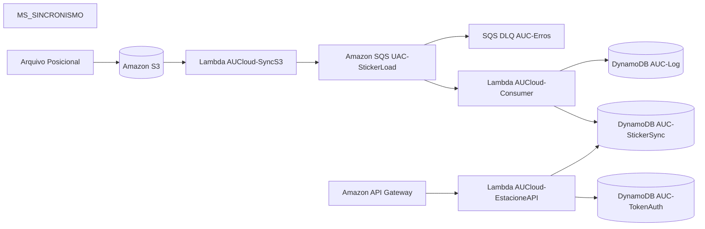
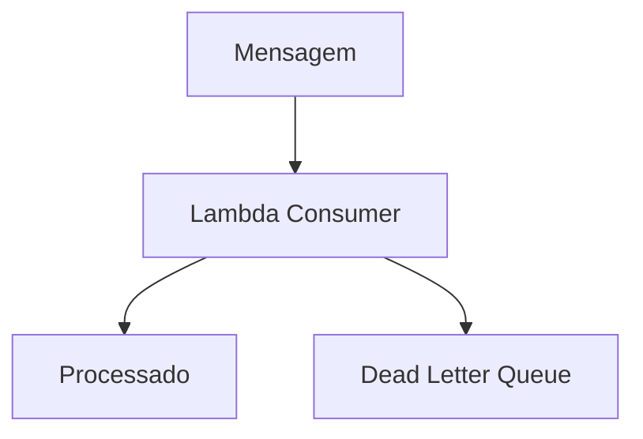

# Arquitetura da Solução AWS

## Objetivo

Este documento descreve a arquitetura serverless proposta para o processamento assíncrono de arquivos utilizando serviços gerenciados da AWS.

A solução foi projetada para atender os seguintes requisitos:

- Processamento assíncrono de arquivos
- Baixo acoplamento entre componentes
- Escalabilidade automática
- Alta disponibilidade
- Infraestrutura como Código (IaC)
- Arquitetura orientada a eventos

---

# Visão Geral da Arquitetura



---

# Fluxo de Negócio

## 1. Ingestão de Arquivos

O sistema MS_SINCRONISMO gera arquivos posicionais e os envia para o bucket Amazon S3.

## 2. Disparo de Evento

Após o upload, um evento ObjectCreated aciona a Lambda AUCloud-SyncS3.

## 3. Publicação na Fila

A Lambda publica mensagens na fila UAC-StickerLoad.

## 4. Processamento Assíncrono

A Lambda AUCloud-Consumer consome as mensagens da fila.

## 5. Persistência

Os dados são armazenados na tabela AUC-StickerSync e os registros operacionais na tabela AUC-Log.

---

# Fluxo de Autorização

Endpoint:

```http
POST /v1/estacione/autoriza
```

A Lambda AUCloud-EstacioneAPI consulta a tabela AUC-TokenAuth e atualiza a tabela AUC-StickerSync.

---

# Serviços AWS Utilizados

- Amazon S3
- AWS Lambda
- Amazon SQS
- Amazon DynamoDB
- Amazon API Gateway
- AWS IAM
- AWS CloudFormation

---

# Escalabilidade

Todos os componentes da arquitetura utilizam serviços gerenciados e escaláveis da AWS.

---

# Recuperação de Falhas



---

# Infraestrutura como Código

Toda a infraestrutura é provisionada pelo arquivo:

```text
infra/cloudformation.json
```

Recursos provisionados:

- Bucket S3
- Filas SQS
- Funções Lambda
- Tabelas DynamoDB
- API Gateway
- IAM Roles

---

# Considerações Finais

Esta arquitetura segue os princípios de Event-Driven Architecture (EDA), Serverless Computing e Infrastructure as Code (IaC), fornecendo uma solução escalável, resiliente e de baixo custo operacional.
