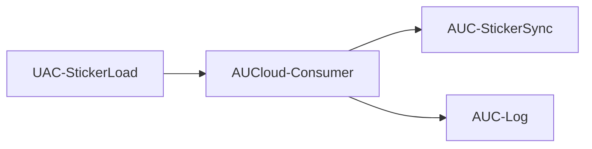
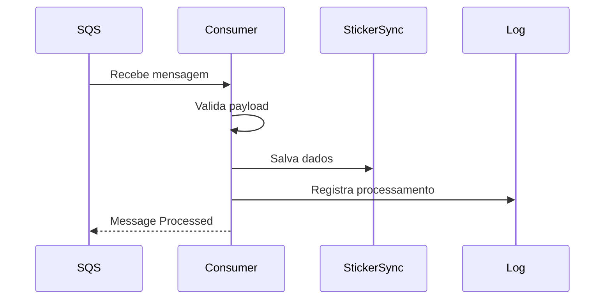
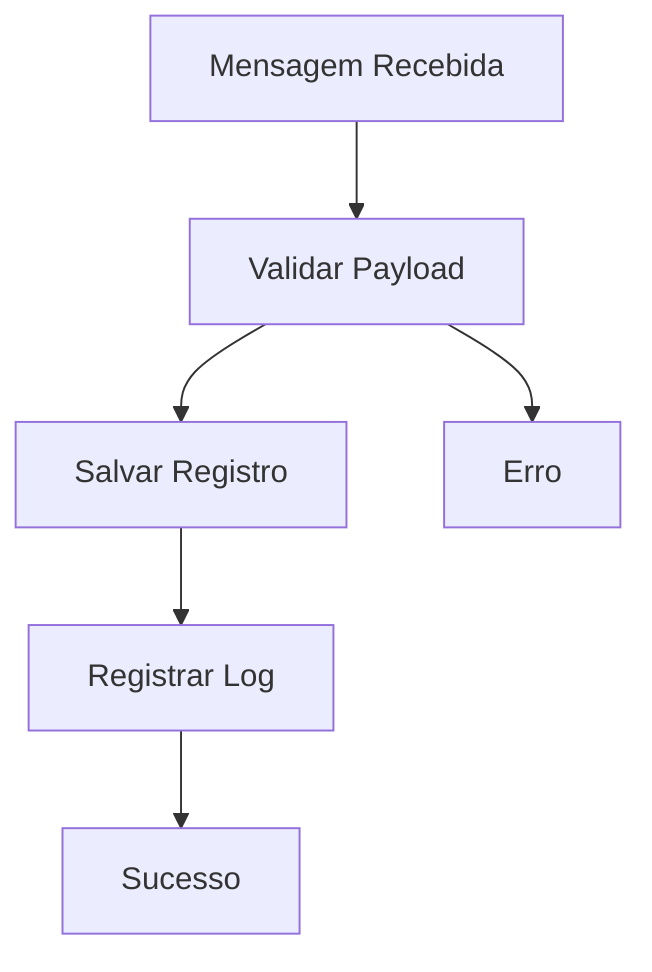

# AUCloud-Consumer

## Visão Geral

A função **AUCloud-Consumer** é responsável pelo processamento assíncrono das mensagens recebidas da fila Amazon SQS.

Seu objetivo é consumir os eventos publicados pela Lambda **AUCloud-SyncS3**, validar o conteúdo recebido e persistir os dados nas tabelas DynamoDB da aplicação.

Esta Lambda representa a camada de processamento da arquitetura orientada a eventos.

---

## Responsabilidades

- Consumir mensagens da fila SQS
- Validar payload recebido
- Aplicar regras de negócio
- Persistir dados na tabela AUC-StickerSync
- Registrar logs na tabela AUC-Log
- Registrar métricas e logs de execução

### Não é responsabilidade desta Lambda

- Ler arquivos diretamente do S3
- Receber chamadas HTTP
- Gerenciar autenticação de usuários
- Expor APIs REST

Estas responsabilidades pertencem às funções:

```text
AUCloud-SyncS3
```

e

```text
AUCloud-EstacioneAPI
```

---

## Fluxo da Arquitetura



---

## Fluxo Completo



---

## Fluxo de Processamento



---

## Estrutura do Projeto

```text
consumer/
│
├── lambda_function.py
├── requirements.txt
├── event.json
└── README.md
```

---

## Evento Recebido

Exemplo de mensagem entregue pelo Amazon SQS:

```json
{
  "Records": [
    {
      "messageId": "123456",
      "body": "{\"file_name\":\"arquivo.json\",\"data\":{\"id\":\"1\",\"placa\":\"ABC1234\",\"valor\":20.50}}"
    }
  ]
}
```

---

## Payload Processado

Após desserialização:

```json
{
  "file_name": "arquivo.json",
  "data": {
    "id": "1",
    "placa": "ABC1234",
    "valor": 20.50
  }
}
```

---

## Estrutura da Tabela AUC-StickerSync

Exemplo de item persistido:

```json
{
  "id": "1",
  "placa": "ABC1234",
  "valor": 20.50,
  "processed_at": "2026-10-16T10:00:00"
}
```

---

## Estrutura da Tabela AUC-Log

Exemplo de log armazenado:

```json
{
  "id": "2026-10-16T10:00:00",
  "status": "SUCCESS",
  "details": "File processed successfully",
  "timestamp": "2026-10-16T10:00:00"
}
```

---

## Variáveis de Ambiente

### STICKER_TABLE

Nome da tabela principal.

```text
AUC-StickerSync
```

---

### LOG_TABLE

Nome da tabela de logs.

```text
AUC-Log
```

---

## Permissões IAM

A função necessita acesso de escrita nas tabelas DynamoDB.

### DynamoDB

```json
{
  "Effect": "Allow",
  "Action": [
    "dynamodb:PutItem"
  ],
  "Resource": [
    "arn:aws:dynamodb:*:*:table/AUC-StickerSync",
    "arn:aws:dynamodb:*:*:table/AUC-Log"
  ]
}
```

### CloudWatch Logs

```json
{
  "Effect": "Allow",
  "Action": [
    "logs:CreateLogGroup",
    "logs:CreateLogStream",
    "logs:PutLogEvents"
  ],
  "Resource": "*"
}
```

---

## Deploy Manual

*mpacotar código:

```bash
zip func*ion.zip lambda_function.py
```

At*alizar Lambda:

```bash
aws lambda*update-function-code \
    --funct*on-name AUCloud-Consumer \
    --z*p-file fileb://function.zip
```

-*-

## Teste Local

Executar:

*``bash
python lambda_function.py
`*`

Invocação usando AWS CLI:

```b*sh
aws lambda invoke \
    --funct*on-name AUCloud-Consumer \
    --p*yload file://event.json \
    resp*nse.json
```

Resposta esperada:

*``json
{
  "statusCode": 200,
  "m*ssage": "Messages processed succes*fully"
}
```

---

## Tratamento d* Erros

Er*os monitorados:

- Payload inválid*
- Campo obrigatório ausente
- Fal*a de conexão com DynamoDB
- Timeou* de processamento
- Problemas de s*rialização
- Falhas de permissão I*M

Os eventos de erro são registra*os em:

```text
Amazon CloudWatch *ogs
```

---

## Recuperação de Fa*has

Em caso de erro* a mensagem poderá ser*reenfileirada pelo*Amazon SQS.

Fluxo:

```mermaid
fl*wchart LR*
    SQS[UAC-StickerLoad*

    CONSUMER[AUCloud-Consumer*

    DLQ[AUC-Erros]

    SQS -->*CONSUMER

    CONSUMER --> DLQ
```*
---

## Observabilidade

Métricas*importantes:

- Invocations
* Duration
- Errors
- ConcurrentExe*utions
-*IteratorAge
* DeadLetterErrors

Serviços utiliz*dos:

- Amazon CloudWatch Logs
- A*azon CloudWatch Metrics

*--

## Melhorias Futuras

- AWS*Lambda Powertools
- Distributed Tr*cing com X-Ray
* Idempotência de mensagens
* Batch Processing
- Validação com *SON Schema
- Integração com EventB*idge
- Testes automatizados com Py*est
- Métricas customizadas*
---

## Dependências

```text
bot*3
```

---

## Autor

Gustavo Bent**
Projeto desenvolvido para demonst*ar uma arquitetura serverless orie*tada a eventos utilizando Amazon*S3, AWS Lambda, Amazon SQS, Dynamo*B,*API Gateway e CloudFormation.
````*