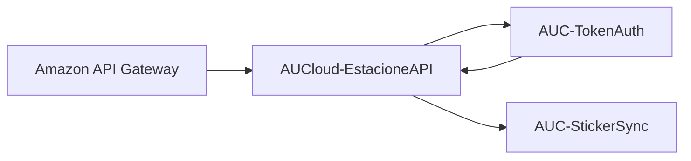
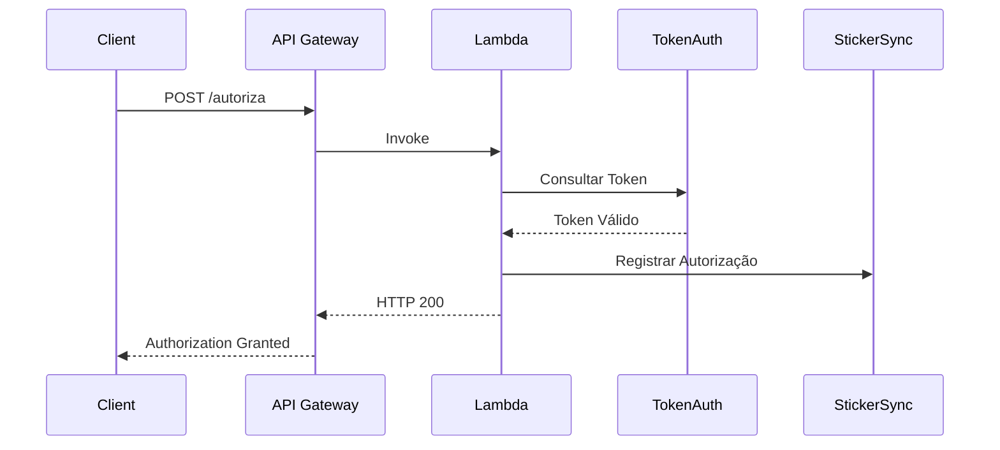
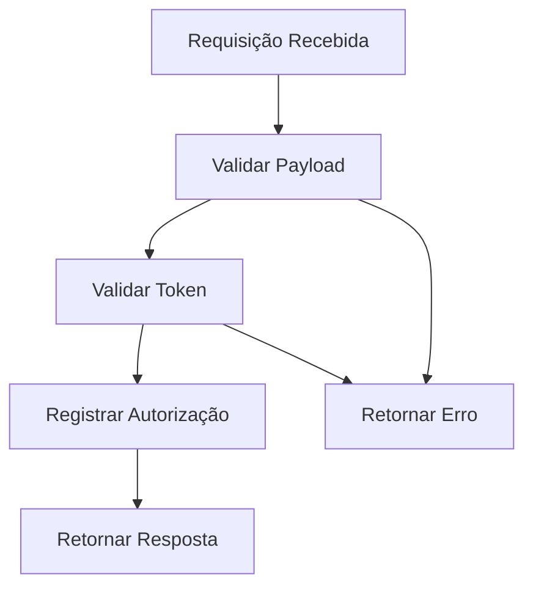

# AUCloud-EstacioneAPI

## Visão Geral

A função **AUCloud-EstacioneAPI** é responsável por receber requisições HTTP através do Amazon API Gateway e realizar o processo de autorização de acesso utilizando tokens armazenados no Amazon DynamoDB.

Esta Lambda representa a camada de integração entre clientes externos e os serviços internos da plataforma.

---

## Responsabilidades

- Receber requisições HTTP do API Gateway
- Validar o payload recebido
- Consultar tokens na tabela AUC-TokenAuth
- Validar autorização de acesso
- Registrar autorizações na tabela AUC-StickerSync
- Retornar respostas HTTP padronizadas
- Registrar logs no CloudWatch

### Não é responsabilidade desta Lambda

- Ler arquivos do Amazon S3
- Processar mensagens SQS
- Persistir logs operacionais
- Realizar sincronismo de arquivos

Estas responsabilidades pertencem às funções:

```text
AUCloud-SyncS3
```

e

```text
AUCloud-Consumer
```

---

## Fluxo da Arquitetura



---

## Fluxo Completo



---

## Fluxo de Processamento



---

## Estrutura do Projeto

```text
estacione-api/
│
├── lambda_function.py
├── requirements.txt
├── event.json
└── README.md
```

---

## Endpoint Disponível

### Autorização

```http
POST /v1/estacione/autoriza
```

---

## Payload de Entrada

```json
{
  "token": "abc123",
  "placa": "ABC1234"
}
```

---

## Evento Recebido da API Gateway

```json
{
  "body": "{\"token\":\"abc123\",\"placa\":\"ABC1234\"}"
}
```

---

## Resposta de Sucesso

```json
{
  "message": "Authorization granted",
  "id": "20261016103000123456"
}
```

HTTP Status:

```http
200 OK
```

---

## Resposta de Token Inválido

```json
{
  "message": "Token not found"
}
```

HTTP Status:

```http
401 Unauthorized
```

---

## Resposta de Payload Inválido

```json
{
  "message": "Missing required fields"
}
```

HTTP Status:

```http
400 Bad Request
```

---

## Estrutura da Tabela AUC-TokenAuth

```json
{
  "token": "abc123",
  "status": "ATIVO"
}
```

---

## Estrutura da Tabela AUC-StickerSync

Registro criado após uma autorização válida:

```json
{
  "id": "20261016103000123456",
  "placa": "ABC1234",
  "token": "abc123",
  "authorized_at": "2026-10-16T10:30:00",
  "status": "AUTHORIZED"
}
```

---

## Variáveis de Ambiente

### TOKEN_TABLE

Tabela responsável pelo armazenamento dos tokens.

```text
AUC-TokenAuth
```

---

### STICKER_TABLE

Tabela responsável pelos registros de autorização.

```text
AUC-StickerSync
```

---

## Permissões IAM

### Consulta de Tokens

```json
{
  "Effect": "Allow",
  "Action": [
    "dynamodb:GetItem"
  ],
  "Resource": [
    "arn:aws:dynamodb:*:*:table/AUC-TokenAuth"
  ]
}
```

### Registro de Autorizações

```json
{
  "Effect": "Allow",
  "Action": [
    "dynamodb:PutItem"
  ],
  "Resource": [
    "arn:aws:dynamodb:*:*:table/AUC-StickerSync"
  ]
}
```

### CloudWatch Logs

```json
{
  "Effect": "Allow",
  "Action": [
    "logs:CreateLogGroup",
    "logs:CreateLogStream",
    "logs:PutLogEvents"
  ],
  "Resource": "*"
}
```

---

## Deploy Manual

Em*acotar função:

```bash
zip functi*n.zip lambda_function.py
```

Atua*izar Lambda:

```bash
aws lambda u*date-function-code \
    --functio*-name AUCloud-EstacioneAPI \
    -*zip-file fileb://function.zip
```
*---

## Teste Local

Executar:

``*bash
python lambda_function.py
```*
Invocação via AWS CLI:

```bash
a*s lambda invoke \
    --function-n*me AUCloud-EstacioneAPI \
    --pa*load file://event.json \
    respo*se.json
```

---

## Teste da API
*Utilizando cURL:

```bash
curl --r*quest POST \
--url https://URL/v1/estacione/autoriza \
--header 'Cont*nt-Type: application/json' \
--dat* '{
  "token":"abc123",
  "placa":*ABC1234"
}'
```

---

## Tratament* de Erros

Erros monitorados:

- T*ken inexistente
- Token inativo
- *ayload inválido
- Problemas de com*nicação com DynamoDB
- Timeout da *ambda
- Falhas de permissão IAM

T*dos os erros são registrados autom*ticamente em:

```text
Amazon Clou*Watch Logs
```

---

## Observabil*dade

Principais métricas monitora*as:

- Invocations
- Duration
- Er*ors
- Throttles
- ConcurrentExecut*ons

Serviços utilizados:

- Amazo* CloudWatch Logs
- Amazon CloudWat*h Metrics

---

## Dependências

`*`text
boto3
```

---

## Melhorias*Futuras

- AWS Lambda Powertools
-*OpenAPI Documentation
- JWT Authen*ication
- Amazon Cognito
- Version*mento de API
- Rate Limiting
- Req*est Validation
- Distributed Traci*g com AWS X-Ray
- Testes automatiz*dos com Pytest

---

## Autor

Gus*avo Bento

Projeto desenvolvido pa*a estudo de arquitetura Serverless*na AWS utilizando Amazon API Gatew*y, AWS Lambda, Amazon DynamoDB, Am*zon SQS, Amazon S3 e AWS CloudForm*tion.