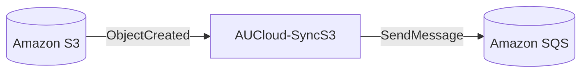
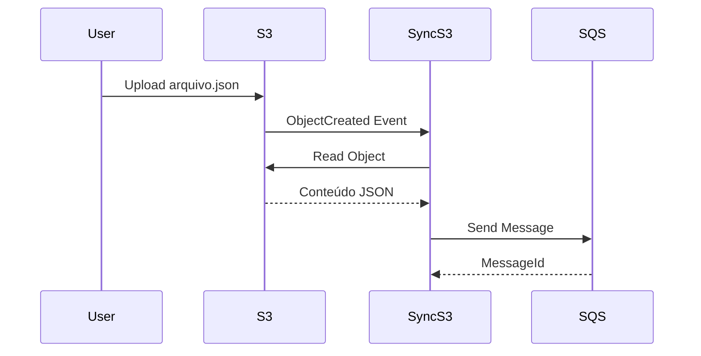

# AUCloud-SyncS3

## Visão Geral

A função **AUCloud-SyncS3** é responsável pela ingestão inicial dos arquivos enviados para o bucket Amazon S3.

Sempre que um novo arquivo é criado no bucket configurado, um evento do S3 aciona esta Lambda, que realiza a leitura do arquivo e publica seu conteúdo em uma fila Amazon SQS para processamento assíncrono.

Sua principal responsabilidade é desacoplar a ingestão do processamento de negócio.

---

## Responsabilidades

- Receber eventos do Amazon S3
- Ler arquivos armazenados no bucket
- Validar a estrutura mínima do conteúdo
- Montar mensagem padronizada
- Publicar mensagem na fila SQS
- Registrar logs no CloudWatch

### Não é responsabilidade desta Lambda

- Aplicar regras de negócio
- Persistir dados no DynamoDB
- Consultar APIs externas
- Gerar relatórios

Estas responsabilidades pertencem à Lambda AUCloud-Consumer.

---

## Fluxo da Arquitetura



---

## Fluxo Completo



---

## Estrutura do Projeto

```text
syncs3/
├── lambda_function.py
├── requirements.txt
├── README.md
└── event.json
```

---

## Variáveis de Ambiente

### QUEUE_URL

URL da fila utilizada pelo Amazon SQS.

---

## Tratamento de Erros

- Arquivo inexistente
- Bucket inválido
- JSON inválido
- Falha ao enviar mensagem ao SQS
- Timeout
- Falha de permissão IAM

---

## Melhorias Futuras

- Suporte a arquivos CSV
- Validação de schema JSON
- Lambda Powertools
- Dead Letter Queue
- Testes automatizados com Pytest
